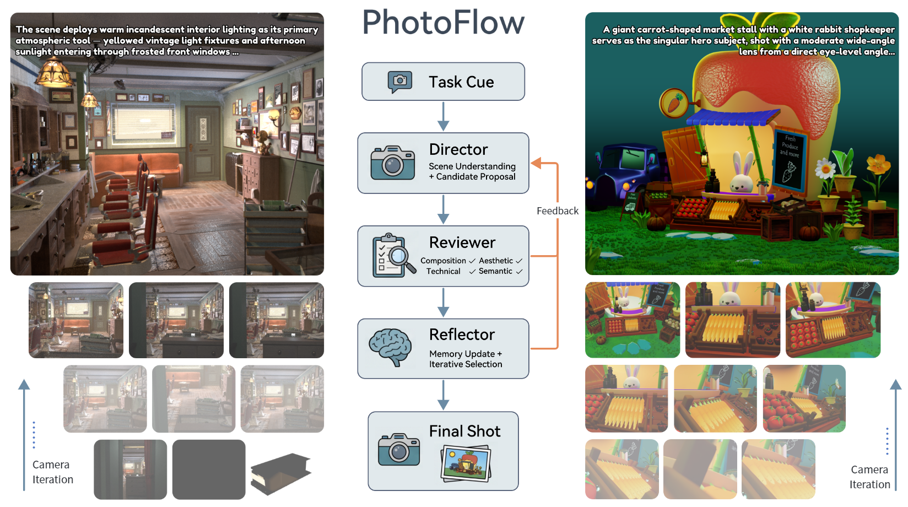
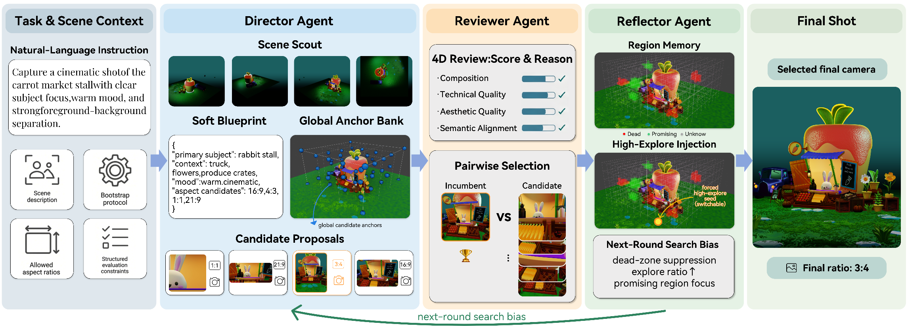

# [NeurIPS 2026] PhotoFlow: Agentic 3D Virtual Photography Missions

<p align="left">
  <a href="https://arxiv.org/abs/2605.23771"></a>
  <a href="https://visionary-laboratory.github.io/PhotoFlow/"></a>
  <a href="https://huggingface.co/papers/2605.23771"></a>
  <a href="https://huggingface.co/datasets/sjijs/VPhotoBench"></a>
</p>

**PhotoFlow** is an agentic framework for language-conditioned virtual photography in controllable 3D scenes. Given a Blender scene and a natural-language photography intent, PhotoFlow searches for an executable camera state—camera position, look-at target, focal length, aperture, and aspect ratio—and renders the final photograph.



## Overview

PhotoFlow treats virtual photography as a closed-loop spatial-aesthetic search problem:

- **Director** builds a soft photographic blueprint and proposes diverse candidates from scene scouts, global anchors, and region memory.
- **Reviewer** combines projection/rule indicators, visual critique, and pairwise incumbent selection.
- **Reflector** converts failures into region-memory updates, dead-zone suppression, and high-exploration relocation.



## Code structure

This repository releases the **agent implementation only**. Experiment-specific server scripts, raw logs, and analysis pipelines are not included. VPhotoBench is distributed separately on Hugging Face.

```text
photoflow/agent_vlm.py       Role prompts and OpenAI-compatible VLM client
photoflow/env_blender.py     Scene inspection, camera control, and rendering
photoflow/blender_render.py  External Blender rendering helpers
photoflow/main.py            Agent entry point and search loop
photoflow/main_pipeline.py   Compatibility wrapper for the same entry point
```

## Installation

Requirements:

- Python 3.10+
- Blender 4.4.3 recommended
- An OpenAI-compatible API endpoint and API key

Install the SDK in your normal Python environment and Blender's embedded Python:

```bash
pip install -r requirements.txt

blender --background --python-expr \
  "import sys,subprocess; subprocess.check_call([sys.executable,'-m','ensurepip','--upgrade'])"
blender --background --python-expr \
  "import sys,subprocess; subprocess.check_call([sys.executable,'-m','pip','install','openai>=1.0,<2'])"
```

Configure environment variables without hard-coding credentials:

```bash
export BLENDER_PATH=blender
export LLM_API_BASE=https://api.openai.com/v1
export LLM_API_KEY=<your-api-key>
export LLM_MODEL=gpt-5.4
```

`env.example` contains placeholders only. Set `BLENDER_PATH` to your Blender executable if it is not on `PATH`; set `LLM_API_BASE` and `LLM_MODEL` for your provider.

## Run the agent

List exact Blender object names without calling the LLM:

```bash
"$BLENDER_PATH" -b /path/to/your_scene.blend -P photoflow/main.py -- --list-objects
```

Run PhotoFlow:

```bash
"$BLENDER_PATH" -b /path/to/your_scene.blend -P photoflow/main.py -- \
  --instruction "A cinematic photograph of the main subject with clear spatial depth" \
  --reference "ExactBlenderObjectName" \
  --random-seed 0 \
  --max-iter 6 \
  --num-candidates 4 \
  --scout-views 4 \
  --preview-samples 64 \
  --preview-workers 2 \
  --final-samples 128 \
  --render-engine CYCLES \
  --output output/final_image.png
```

`--reference` can be omitted when the scene and instruction provide enough context, but an exact object name is recommended for subject-specific tasks. Use `EEVEE` when appropriate for the scene and hardware.

Outputs include the final image, scout views, iteration previews, and a JSON run log. Preview samples are capped at 64. If external parallel rendering is unavailable, the pipeline falls back to serial previews. See `photoflow/README.md` for the runtime-file overview.

## Use VPhotoBench

[VPhotoBench on Hugging Face](https://huggingface.co/datasets/sjijs/VPhotoBench) contains **47 Creative-Commons-licensed Blender scenes** and **141 language-conditioned missions** across three task types: subject placement, relational composition, and atmosphere/style.

### Download

Download through the dataset page, or use the Hugging Face SDK:

```bash
pip install huggingface_hub
python - <<'PY'
from huggingface_hub import snapshot_download

root = snapshot_download(
    repo_id="sjijs/VPhotoBench",
    repo_type="dataset",
    local_dir="VPhotoBench",
)
print(root)
PY
```

### Select a scene and mission

The runner-compatible metadata is in `benchmark/scene_registry_v1.json` and `benchmark/tasks_v1.json`. The following example prints the instruction and scene path for the first mission:

```python
import json
from pathlib import Path

root = Path("VPhotoBench")
tasks = json.loads((root / "benchmark/tasks_v1.json").read_text())["tasks"]
scenes = {
    item["scene_id"]: item
    for item in json.loads((root / "benchmark/scene_registry_v1.json").read_text())["scenes"]
}

task = tasks[0]
scene = scenes[task["scene_id"]]
print("Instruction:", task["instruction_en"])
print("Reference object:", task.get("reference_object"))
print("Blender scene:", root / scene["blend_file"])
```

Pass these values to `photoflow/main.py`:

```bash
"$BLENDER_PATH" -b "VPhotoBench/<path-from-scene_registry>" -P photoflow/main.py -- \
  --instruction "<instruction_en>" \
  --reference "<reference_object-if-provided>" \
  --render-engine CYCLES \
  --output output/vphotobench_example.png
```

Use the scene's default render configuration and the task's allowed aspect ratios when running benchmark comparisons. Third-party Blender assets remain governed by their original licenses; see the dataset card for per-asset attribution and license metadata.

## Benchmark evaluation

A benchmark output consists of a final rendered image and its executable, rerenderable camera state. The main perceptual evaluation uses UniPercept:

- **IAA**: image aesthetic assessment
- **IQA**: image quality assessment
- **ISTA**: image structure and texture richness

The reported composite is:

```text
M_pq = 0.40 × IAA + 0.20 × IQA + 0.40 × ISTA
```

ISTA does not measure instruction alignment. Task instructions and structured evaluation constraints are provided in the benchmark metadata for additional evaluation. The internal Reviewer score is used by the agent during search and should not be substituted for external benchmark metrics.

## Resources

- Paper: [arXiv:2605.23771](https://arxiv.org/abs/2605.23771)
- Hugging Face paper page: [huggingface.co/papers/2605.23771](https://huggingface.co/papers/2605.23771)
- Project page: [visionary-laboratory.github.io/PhotoFlow](https://visionary-laboratory.github.io/PhotoFlow/)
- Benchmark dataset: [VPhotoBench on Hugging Face](https://huggingface.co/datasets/sjijs/VPhotoBench)

## Citation

```bibtex
@misc{guo2026photoflowagentic3dvirtual,
      title={PhotoFlow: Agentic 3D Virtual Photography Missions},
      author={Jiarui Guo and Haojia Wei and Yiming Zhang and Yifei Liu and Yuning Gong and Hongjie Zhang and Xue Yang and Zhihang Zhong},
      year={2026},
      eprint={2605.23771},
      archivePrefix={arXiv},
      primaryClass={cs.CV},
      url={https://arxiv.org/abs/2605.23771},
}
```

## License

Agent code is released under the MIT License; see `LICENSE`. Blender and the OpenAI SDK remain subject to their own licenses. Third-party `.blend` scenes and other assets are not covered by this repository's code license.
